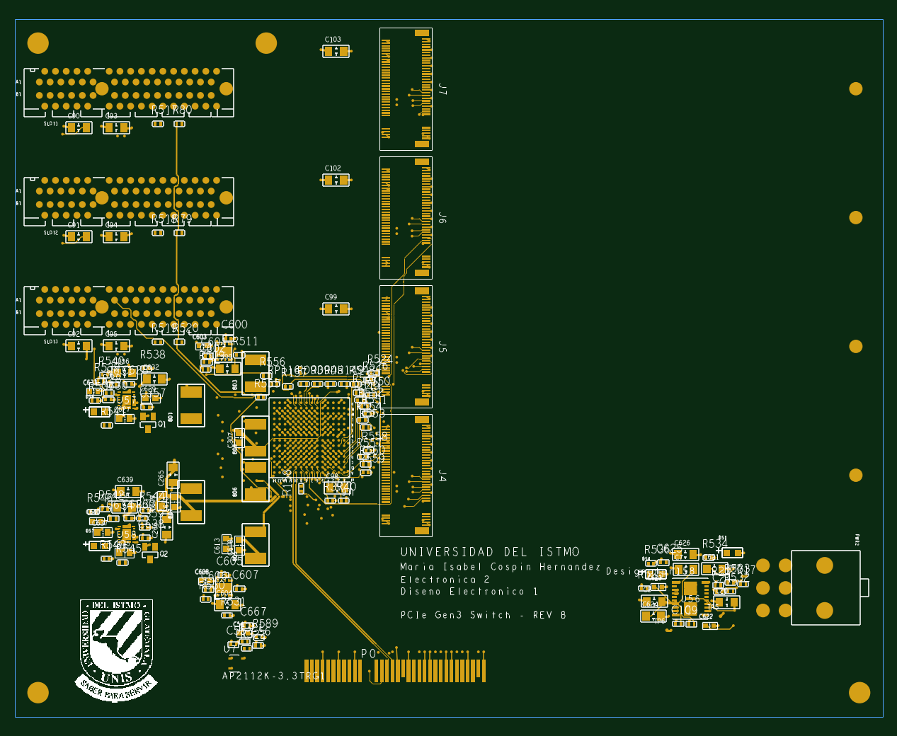

# Entrega Proyecto Final – Electrónica 2 y Diseño Electrónico 1

Este es el repo de mi proyecto final. Es una placa **switch PCIe Gen3** basada en el chip **PI7C9X3G808GP** (Diodes/Pericom). Toma un enlace PCIe x4 del lado de la computadora (el conector de borde P0) y lo reparte a **3 slots PCIe x4** y **4 conectores M.2 (Key M)**.

La diseñé en **OrCAD X / Allegro 25.1**. Los componentes los escogí pensando en que se pueda mandar a hacer y ensamblar en **JLCPCB**, por eso el BOM trae los números LCSC.

**María Isabel Cospín Hernández**
Universidad del Istmo – Electrónica 2 / Diseño Electrónico 1

---

## ¿Qué hay en cada carpeta?

| Carpeta | Qué es |
|---|---|
| `Esquematico/` | El esquemático en OrCAD Capture (`.DSN`). Trae portada y notas. Como la entrega era de **alta velocidad y potencia**, solo dibujé a detalle esas partes. Los pines que no se usan van con su "X" de *no connect*. |
| `PCB/` | El layout en Allegro (`.brd`). Ahí está todo el ruteo, los planos y el stackup. |
| `BOM/` | La lista de materiales en `.csv` con el formato que pide JLCPCB (Comment, Designator, Footprint, LCSC Part #, Quantity). |
| `Gerbers/` | Los archivos para fabricar: las 6 capas de cobre, serigrafía, máscara, pasta, contorno y los taladros. También viene todo junto en `Gerbers_PCIE_SWITCH_REVB.zip` para subirlo directo a JLCPCB. |
| `img/` | Una vista previa de la placa sacada de los gerbers. |

### Los gerbers, uno por uno

| Archivo | Capa |
|---|---|
| `.GTL` | Cobre TOP (componentes y salida del BGA) |
| `.G1` | GND_1 (plano de tierra) |
| `.G2` | SIGNAL_1 (capa interna para las señales rápidas) |
| `.G3` | POWER (planos de alimentación) |
| `.G4` | GND_2 (plano de tierra) |
| `.GBL` | Cobre BOTTOM (capacitores de desacople) |
| `.GTO` / `.GBO` | Serigrafía top / bottom |
| `.GTS` / `.GBS` | Máscara de soldadura top / bottom |
| `.GTP` / `.GBP` | Pasta para el stencil top / bottom |
| `.GKO` | Contorno de la placa |
| `-PTH.drl` / `-NPTH.drl` | Taladros metalizados y no metalizados (Excellon, en mm) |

Todos van en formato Gerber RS274X, en milímetros.

---

## Lo que se hizo (resumido)

**Stackup de 6 capas:** TOP / GND_1 / SIGNAL_1 / POWER / GND_2 / BOTTOM. Así cada capa de señal tiene un plano de tierra al lado.

**Alta velocidad**
- Los 16 carriles de datos PCIe (TX/RX) van ruteados como **pares diferenciales**. Usé reglas de 85 Ω para los datos y de 100 Ω para los relojes (REFCLK). Debajo del BGA hay *neck-down* porque el espacio entre bolas es muy poco.
- Los capacitores de acople AC de los M.2 (C649–C656) los pasé a BOTTOM, justo a la par del conector.
- La mayoría de los relojes REFCLK llegan a su slot o M.2. Algunas resistencias en serie las moví de lugar porque no había espacio para sacar las pistas.

**Potencia**
- Hay planos de tierra completos en GND_1 y GND_2.
- En la capa POWER hay **una sola figura por cada voltaje**, cada una de su color: 12V, 3.3V, 3.3VAUX, 1.8V, 0.95V del core, 0.95V de la PHY, 1.8V DDR, etc. Cada figura llega a todo lo que alimenta.
- Todos los capacitores y pines de alimentación tienen su vía hacia el plano. Algunos capacitores del BGA los moví porque no cabía la vía.
- La alimentación viene del conector de 12 V (PWR2). De ahí salen reguladores TPSM843B22 (12V→3.3V), TPSM843620 (núcleos de 0.95V) y AP7361C (1.8V y 0.95V). Cada riel pasa por su ferrita hacia el chip.

**Otros detalles**
- La placa lleva 4 agujeros de montaje en las esquinas, más los standoffs de los M.2.
- En la serigrafía van el logo de la UNIS, mi nombre y las clases.
- El DRC solo tiene errores con *waiver* documentado. Casi todos vienen de las huellas del fabricante (los agujeros de retención del slot PCIe y los anclajes del M.2). Los demás son unos capacitores 0402 algo juntos, que igual se pueden ensamblar.

---

## Lo que quedó pendiente

- **5 relojes no se pudieron rutear:** REFCLKON1, ON2, ON3, ON5 y REFCLKN_SL7. Esas bolas del BGA quedaron rodeadas de otras pistas. Para conectarlos habría que rehacer parte del ruteo de los relojes vecinos.
- **No hice la igualación de largos** entre P y N de los pares.
- Quedan sin conectar 2 bolas de alimentación del BGA (F10 de 0.95VP y L8 de 1.8VPH) y un par de pines de GND/3.3V que estaban muy encerrados.
- Las señales de control lentas (configuración, LEDs, I2C, etc.) no se rutearon, porque la entrega era solo de alta velocidad y potencia.

---

### Cómo abrir los archivos
- `.DSN` → OrCAD Capture (17.4 o más nuevo; yo usé OrCAD X 25.1).
- `.brd` → Allegro / OrCAD X PCB 25.1.
- Gerbers → cualquier visor (por ejemplo el de JLCPCB o Gerbv). También se puede subir el `.zip` directo a la página de JLCPCB.
